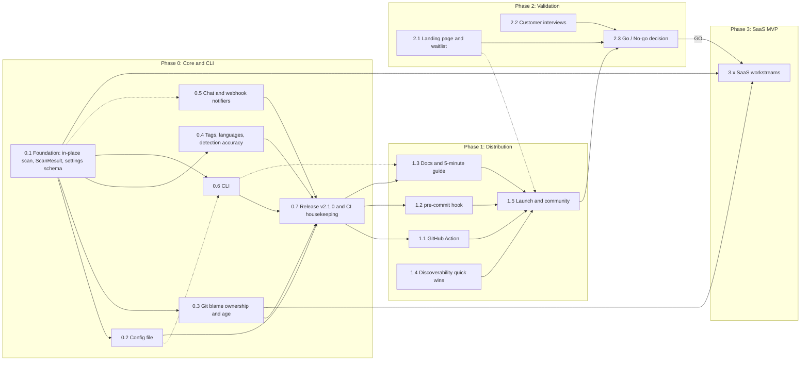

# TODO Notifier: Product Roadmap

This folder holds the execution plan for turning TODO Notifier from a Python library into a
widely adopted developer tool and, if demand is proven, a SaaS product.

Each phase file is written so that it can be handed to an agent (or a contributor) as a
self-contained brief. Each phase is split into **workstreams** (e.g. `0.3`). A workstream is
the unit of work for one agent and one pull request.

| File | Phase | Goal | Where the work happens |
|---|---|---|---|
| [phase-0-core.md](phase-0-core.md) | 0: Core and CLI | Remove setup friction: CLI, config file, git-aware ownership, accurate detection, chat notifiers | This repo |
| [phase-1-distribution.md](phase-1-distribution.md) | 1: Distribution | Be where developers already are: GitHub Action, pre-commit, docs, discoverability, launch | This repo + new `todonotifier-action` repo |
| [phase-2-validation.md](phase-2-validation.md) | 2: SaaS validation | Prove teams will pay before building anything hosted | Mostly non-code (landing page, interviews) |
| [phase-3-saas-mvp.md](phase-3-saas-mvp.md) | 3: SaaS MVP | GitHub App, dashboard, digests, billing | New private repo `todonotifier-cloud` |

> ⚠️ Effort estimates throughout are rough guesses for one developer working with coding
> agents. They are not benchmarks.

## Dependency graph

Solid arrows are **hard** dependencies (cannot start or cannot finish without them). Dotted
arrows are **soft** dependencies (can start in parallel against an agreed interface, then
integrate).



## Execution waves (what can run in parallel)

| Wave | Start condition | Run in parallel | Notes |
|---|---|---|---|
| **1** | Now | `0.1` Foundation, `1.4` Discoverability, `2.1` Landing page, `2.2` Interview script and recruiting | `1.4`, `2.1` and `2.2` touch nothing in the library code, so there is no merge-conflict risk with `0.1`. |
| **2** | `0.1` merged | `0.2` Config file, `0.3` Git blame, `0.4` Detection, `0.5` Notifiers, `0.6` CLI, `1.3` Docs (drafting only) | Each touches mostly separate modules (see "File ownership" below). `0.6` integrates `0.2` once it merges. `0.5` may start before `0.1` merges, coding against the `ScanResult` interface defined in `0.1`. |
| **3** | All of `0.2` to `0.6` merged | `0.7` Release | Single agent. Publishes `v2.1.0` to PyPI. |
| **4** | `v2.1.0` published | `1.1` GitHub Action, `1.2` pre-commit hook, `1.3` Docs (finalize) | All three need a published version to pin to. |
| **5** | `1.1` to `1.4` done | `1.5` Launch | Landing page (`2.1`) should be live by now so launch traffic can join the waitlist. |
| **6** | 4 to 6 weeks after launch | `2.3` Go / No-go | A decision by the maintainer, informed by the metrics and interview notes. |
| **7** | `2.3` = GO | Phase 3 (see its own internal waves) | Phase 3 reuses the `0.1` scanner API and `0.3` git metadata as its scan engine. |

### Hard vs soft dependencies at a glance

| Workstream | Hard dependencies | Soft dependencies (start early, integrate later) |
|---|---|---|
| 0.1 | none | none |
| 0.2 | 0.1 | none |
| 0.3 | 0.1 | none |
| 0.4 | 0.1 | none |
| 0.5 | none (needs the `ScanResult` interface from 0.1) | 0.1 |
| 0.6 | 0.1 | 0.2, 0.3, 0.4 (flags are wired through the settings schema) |
| 0.7 | 0.2, 0.3, 0.4, 0.5, 0.6 | none |
| 1.1 | 0.7 (published package), 0.6 | 0.3, 0.5 |
| 1.2 | 0.7, 0.6 | none |
| 1.3 | 0.7 (final content) | 0.6 (drafting) |
| 1.4 | none | none |
| 1.5 | 1.1, 1.2, 1.3, 1.4 | 2.1 |
| 2.1 | none | none |
| 2.2 | none | 2.1 (waitlist is a recruiting source) |
| 2.3 | 1.5, 2.1, 2.2 | none |
| 3.x | 2.3 = GO, 0.1, 0.3 | 0.4, 0.5 |

### File ownership in Wave 2 (to avoid merge conflicts)

| Workstream | Owns (creates or mainly edits) | May touch lightly |
|---|---|---|
| 0.2 | `todonotifier/settings_file.py` (new) | `todonotifier/settings.py`, `pyproject.toml` (deps) |
| 0.3 | `todonotifier/git_meta.py` (new) | `todonotifier/scanner.py` (one hook call) |
| 0.4 | `todonotifier/todo_notifier.py`, `todonotifier/languages.py` (new), `todonotifier/constants.py` | `todonotifier/utils.py` |
| 0.5 | `todonotifier/notifier.py`, `todonotifier/digest.py` (new) | none |
| 0.6 | `todonotifier/cli.py` (new), `todonotifier/__main__.py` (new), `todonotifier/formatters.py` (new) | `pyproject.toml` (scripts) |

Everyone adds to `README.md`'s changelog. Resolve those conflicts by keeping all entries.

## Rules every agent must follow

**Workflow**
- One workstream = one branch = one PR. Branch name: `roadmap/<id>-<slug>` (e.g.
  `roadmap/0.3-git-blame`). Target the branch the maintainer names (default `main`).
- Read this file, then the relevant phase file, then the code you will change. Do not start a
  workstream whose **hard** dependencies are not merged.
- Stay inside your workstream's scope. If you find out-of-scope issues, list them in the PR
  description under "Follow-ups" instead of fixing them.
- Add an entry to the changelog section of `README.md`.

**Library code (this repo, Phases 0 and 1)**
- **Python compatibility:** the package declares `python = "^3.9"` in `pyproject.toml`. Until the
  maintainer resolves decision **D1** below, write code that runs on 3.9: no `match`, no
  `X | Y` type unions at runtime, use `typing.List` / `Optional` like the existing code. For
  TOML, use `tomllib` on 3.11+ and `tomli` below that.
- **Dependencies:** keep runtime dependencies minimal (currently `gitpython`,
  `python-dateutil`, `jinja2`). Prefer the standard library (`argparse`, `urllib.request`,
  `dataclasses`, `json`). Adding a runtime dependency needs a one-line justification in the PR.
  Pydantic is not used in the library. It is used in the SaaS backend (Phase 3).
- **Backwards compatibility:** Phase 0 ships as `v2.1.0`, a non-breaking minor release.
  `todonotifier.driver.run(connect, config)`, `DefaultConfig`, `Connect`, `ConnectMethod`,
  `BaseSummaryGenerator`, `BaseNotifier` and `EmailNotifier` must keep working unchanged.
  New behavior is opt-in through the library API, and on by default only through the new CLI
  or config file.
- **Style:** Black (line length 160, `pyproject.toml`), isort (black profile), flake8
  (`tox.ini`). Type hints on all arguments, return values and variables. Google-style
  docstrings. Match the existing module docstring and comment style.
- **Tests:** `unittest`-style test classes in `tests/`, run with `pytest`. Every new module has a
  matching `tests/test_<module>.py`. Mock network and SMTP. For git behavior, build a temporary
  repo inside the test (set `GIT_AUTHOR_DATE` / `GIT_COMMITTER_DATE` / author env vars so the
  results are deterministic).
- **Before pushing:** run `pytest`, `black --check .`, `isort --check-only .` and
  `flake8 . --config ./tox.ini`.
- **Security:** never put secrets in config files or logs. Notifiers read secrets from
  environment variables. Use `subprocess` with list arguments (never `shell=True`).

**SaaS code (Phase 3, separate repo)**
- Python 3.11+, FastAPI + uvicorn, Pydantic v2 (including `pydantic-settings`), async I/O
  (`httpx`, `asyncio.gather` for independent calls), Google-style docstrings and full type hints.

## Open decisions for the maintainer

Agents must not decide these. If a workstream is blocked on one, stop and ask.

| ID | Decision | Recommendation | Blocks |
|---|---|---|---|
| D1 | Minimum Python version. 3.9 reached end of life in Oct 2025 and 3.10 reaches it in Oct 2026 ([python.org release status](https://devguide.python.org/versions/)) | Keep `^3.9` for `v2.1.0` to stay non-breaking. Raise to `>=3.11` in a later `v3.0.0`. | 0.7 (CI matrix) |
| D2 | Host the GitHub Action in a separate repo or in this repo | Separate repo `todonotifier-action`, for clean `v1` tags and its own Marketplace listing | 1.1 |
| D3 | SaaS code: private repo or open core | Private repo. The library stays MIT. | Phase 3 |
| D4 | Default due date for TODOs without `{date}` | No default (current behavior). Opt-in `default_due_days` setting. | 0.3 |
| D5 | Default file extensions for the CLI | Common-languages set for the CLI and config file. Keep `["py"]` for `DefaultConfig` to stay backwards compatible. | 0.4, 0.6 |
| D6 | Product name and domain for the SaaS | Decide during Phase 2 | 2.1, Phase 3 |

## Known defects to fix early (verified on `main`)

| Defect | Evidence | Fixed in |
|---|---|---|
| False-positive TODOs: `re.search(r"TODO", line)` has no word boundary and does not check for a comment, so with `ignore_todo_case=True`, `from todonotifier.config import X` is reported as a TODO with message `notifier.config import X`. `TODO_REGEX_PATTERN = ...` and `"TODO list"` inside strings also match. | `todonotifier/todo_notifier.py:18`, `:78`, `:111` | 0.4 |
| Summary generators keep their `container` between runs, and `driver.run` defaults to a shared module-level `default_config`, so calling `run()` twice may duplicate rows. ⚠️ Verify with a test first. | `todonotifier/driver.py:25`, `todonotifier/summary_generators.py` | 0.1 |
| `ConnectMethod.DRY_RUN_DIR` copies the whole directory (including `.git`) into a temp dir before scanning. This is slow on large repos and unnecessary for local scans. | `todonotifier/connect.py:122` | 0.1 |
| README badge row contains literal `\n` characters, so the badges render as broken text. | `README.md:9` | 1.4 |
| CI installs dependencies three times per job (once per step). | `.github/workflows/python-app.yml` | 0.7 |
| No PyPI publish workflow. Releases are manual. | `.github/workflows/` | 0.7 |
| Generated reports in `.report/` are committed to the repo. | `git ls-files .report` | 0.7 |

## How to brief an agent

Copy this and fill in the workstream ID:

```text
You are implementing workstream <ID> of the TODO Notifier roadmap.
1. Read roadmap/README.md (rules, dependencies, open decisions) and roadmap/<phase file>.md.
2. Confirm that every hard dependency of <ID> is merged. If not, stop and report.
3. Implement only the scope of <ID>. Meet every acceptance criterion and add the listed tests.
4. Run the pre-push checks from roadmap/README.md and open a PR from branch roadmap/<ID>-<slug>.
5. In the PR description, list: what changed, how each acceptance criterion is met, and follow-ups.
```
