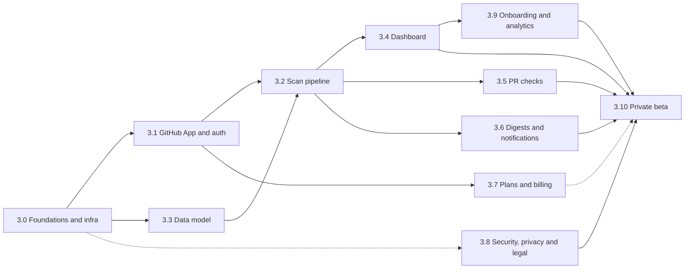

# Phase 3: SaaS MVP

**Start only if [2.3](phase-2-validation.md#23-go--no-go-decision) = GO.**

**Goal:** a hosted product a team can install in 2 minutes. They install a GitHub App, pick
repos, and see a dashboard of TODOs by owner and age, plus a weekly Slack or email digest and
PR checks. The first paying customers come from the waitlist and design partners.

⚠️ Estimated effort: 6 to 10 weeks for one developer with agents.

**Where:** a new private repo, `todonotifier-cloud` (decision D3). It depends on the published
`todonotifier` library. The scan engine is `todonotifier.scanner.scan()` from 0.1, plus the git
metadata from 0.3, so library fixes benefit both products.

**Stack** (follows the maintainer's preferences): Python 3.11+, FastAPI + uvicorn, Pydantic v2
and `pydantic-settings`, SQLAlchemy 2.x (async) + Alembic, PostgreSQL, Redis + an async job
queue (e.g. `arq`), `httpx` for outbound calls (fan out independent calls with
`asyncio.gather`), Docker + docker-compose for local development and deployment.
**Frontend:** server-rendered Jinja2 + htmx, so a solo Python developer does not have to
maintain a separate JS application. A React/Next.js frontend is not part of the MVP.

Read [README.md](README.md) for the shared rules ("SaaS code").

---

## Internal dependency graph

| Wave | Run in parallel |
|---|---|
| A | 3.0 (alone, first) |
| B | 3.1 and 3.3; 3.8 starts (continues throughout) |
| C | 3.2; 3.7 can start once 3.1 is done |
| D | 3.4, 3.5 and 3.6 |
| E | 3.9 |
| F | 3.10 (needs 3.8 complete; 3.7 can be manual invoicing at first) |

---

## 3.0 Foundations and infrastructure

**Size:** M · **Blocks:** everything

This is where Docker and cloud hosting become worth doing.

- Repo scaffold: `app/` (API), `worker/`, `web/` (templates), `migrations/`, `tests/`;
  `pyproject.toml`; pre-commit; CI (lint, type-check with mypy or pyright, tests against a
  Postgres service container).
- `Dockerfile` (multi-stage, non-root user) and `docker-compose.yml` (api, worker, postgres,
  redis).
- Configuration via `pydantic-settings`; secrets only from the environment.
- **Hosting:** start on a managed PaaS (e.g. Render, Railway or Fly.io ⚠️; compare current
  pricing in INR) with managed Postgres and Redis. Move to AWS (ap-south-1, Mumbai) only when
  cost, scale or compliance demands it. Set up separate staging and production environments.
- Observability: structured JSON logs, error tracking (e.g. Sentry ⚠️), a `/healthz`
  endpoint, uptime monitoring.
- Daily database backups with a tested restore.

**Acceptance:** `docker compose up` gives a working "hello" app with a database migration,
CI is green, and staging deploys automatically from `main`.

## 3.1 GitHub App and authentication

**Size:** M · **Depends on:** 3.0

- Register a GitHub App with **minimum permissions**: Metadata (read), Contents (read),
  Pull requests (read), Checks (write, for 3.5). Issues (write) only if the optional
  "Create issue" feature ships.
- Webhooks: `installation`, `installation_repositories`, `push`, `pull_request`. Verify the
  `X-Hub-Signature-256` HMAC on every delivery and deduplicate by the `X-GitHub-Delivery` ID.
- Installation access tokens: mint them on demand, cache them until shortly before they
  expire, and never persist them in plain text.
- Dashboard login with "Sign in with GitHub" (user-to-server OAuth). Map users to
  installations and organizations. Roles: owner and member.

**Acceptance:** installing the App on a test org creates the org and repo records. A webhook
with an invalid signature is rejected with 401. The user can log in and sees only their own
orgs.

## 3.2 Scan pipeline

**Size:** L · **Depends on:** 3.1, 3.3

- A `push` to the default branch (or an initial install) enqueues a scan job, with one active
  job per repo; newer pushes supersede queued ones.
- The worker makes a partial clone (`--filter=blob:none`) with enough history for blame into
  a temp dir, calls `todonotifier.scanner.scan()` with blame on, then **deletes the clone**.
- **Diffing:** each TODO gets a stable fingerprint (hash of the file path plus the normalized
  tag and message) so it can be tracked across line moves. Set `first_seen_at` and
  `resolved_at`, and keep a status of `open` or `resolved`.
- Guardrails: a maximum repo size, a job timeout, retries with backoff, and respect for
  GitHub API rate limits.
- **Store TODO metadata only** (file path, line, tag, message, author, dates), never source
  code.

**Acceptance:** a push that adds and removes TODOs shows up as new and resolved within
2 minutes. A repo larger than the limit fails gracefully with a visible message.

## 3.3 Data model

**Size:** S–M · **Depends on:** 3.0

Entities: `Organization`, `Installation`, `Repository`, `User`, `Membership`, `ScanRun`,
`Todo` (fingerprint, repo, file, line, tag, message, author_login/email, due_date,
created_date, first_seen_at, resolved_at, status), `NotificationChannel`,
`NotificationPreference`, `Subscription`/`Plan`, `AuditLog`. Define Pydantic v2 schemas for
every API payload. Create everything with Alembic migrations.

**Acceptance:** migrations upgrade and downgrade cleanly. Indexes exist on
(repo, status) and (org, author).

## 3.4 Dashboard

**Size:** L · **Depends on:** 3.2

- **Overview per org:** open, overdue, new this week, resolved this week; a trend line over
  time; a TODO-age histogram.
- **Views:** by person ("my TODOs"), by repo, and the full list with filters (repo, owner,
  tag, overdue, age) and search.
- Each TODO deep-links to `github.com/<org>/<repo>/blob/<sha>/<file>#L<line>`.
- Optional: a one-click "Create GitHub issue" button (needs the Issues permission).

**Acceptance:** a design partner can answer "what is overdue and who owns it?" within
30 seconds of logging in.

## 3.5 PR checks

**Size:** M · **Depends on:** 3.2

- On `pull_request`, create a Check Run summarizing TODOs added or changed in the diff, using
  the same logic as the CLI's `--since`, with annotations.
- Per-repo settings: report only, or fail on new overdue TODOs, or fail on TODOs without an
  owner or date.

**Acceptance:** a PR that adds an overdue TODO gets a failing check with an annotation when
the repo is configured to block.

## 3.6 Digests and notifications

**Size:** M · **Depends on:** 3.2

- A weekly digest per person and per team (choose the day and time in the org's time zone),
  covering overdue items, items due soon and new items owned by the recipient.
- Channels: **Slack** (MVP: incoming webhook per channel; a full Slack OAuth app later) and
  **email** through a transactional provider (e.g. Amazon SES, Postmark or Resend ⚠️; compare
  pricing). Teams can come later.
- Unsubscribe links, per-user preferences, and no digest when there is nothing to report.

**Acceptance:** a design partner receives a correct digest on schedule. Unsubscribing works.

## 3.7 Plans and billing

**Size:** M · **Depends on:** 3.1

- **MVP shortcut:** for the first 5 to 10 customers, use manual invoices and payment links,
  and only enforce plan limits in code. Build automated subscriptions once demand justifies it.
- **Automated billing:** Razorpay Subscriptions for INR customers. For international cards,
  evaluate Stripe or Paddle ⚠️; check the current rules for Indian businesses receiving
  international payments.
- Plan limits: number of repos and digest frequency on the free plan; a 14-day trial of Team.
- Tax: GST registration and GST invoices for Indian customers. ⚠️ Confirm the rate,
  registration thresholds and export-of-services treatment with a chartered accountant.

**Acceptance:** an org over its plan limit sees an upgrade prompt and does not get new repos
scanned. A payment (manual or automatic) upgrades the plan.

## 3.8 Security, privacy and legal

**Size:** M (continuous) · **Starts with:** 3.0 · **Must be complete before:** 3.10

- Least-privilege App permissions (3.1). Encrypt tokens and webhook secrets at rest. Rotate
  secrets.
- **Data minimization:** no source code is stored. Clones are deleted after every scan.
  Retention: resolved TODOs are purged after N days (configurable).
- When the App is uninstalled, delete the org's data within 30 days (state this in the
  privacy policy) and offer an immediate "delete my data" button.
- **Legal pages:** Privacy Policy, Terms of Service, and a security page describing what is
  accessed and stored.
- **Compliance:** India's Digital Personal Data Protection Act, 2023 (author names and emails
  are personal data), plus GDPR if you serve EU customers. ⚠️ This is not legal advice; get
  the policies reviewed.
- Dependency and secret scanning in CI (reuse the patterns from this repo's CodeQL, Bandit
  and dependency-review workflows), and an `.env` file that is never committed.

**Acceptance:** the policies are published and the uninstall → deletion flow is tested.
A security self-review checklist (for example the OWASP ASVS Level 1 items that apply) is done.

## 3.9 Onboarding and product analytics

**Size:** S–M · **Depends on:** 3.4

- Flow: install App → choose repos → first scan starts immediately → dashboard shows results
  within about 2 minutes, with an empty-state guide → connect Slack → done.
- Activation metric: "first digest delivered", or "first dashboard view with 1 or more TODOs".
- Product analytics events for install, first scan, first dashboard view, Slack connected,
  digest opened and upgrade (e.g. PostHog ⚠️; it has cloud and self-hosted options).

**Acceptance:** the time from install to first dashboard is measured and is under 5 minutes
for a mid-size repo.

## 3.10 Private beta

**Size:** S–M · **Depends on:** 3.4, 3.5, 3.6, 3.8, 3.9 · **Soft dependency:** 3.7

- Invite design partners first, then the waitlist in batches of 10 to 20.
- Feedback loop: a weekly 15-minute call with each design partner and an in-app feedback link.
- Convert to paid at the end of the trial, with founding-member pricing.
- Track activation, weekly active orgs, digest open rate, retention after 4 weeks and
  conversion to paid.

**Exit:** 3 or more paying teams and a positive retention trend. Then plan the next stage:
GitLab support, a Slack OAuth app, SSO, AI-assisted TODO triage and a self-hosted edition.

---

## Explicitly out of scope for the MVP

GitLab and Bitbucket, a VS Code extension, SSO/SAML, a self-hosted or on-prem edition,
AI features, a public API, a mobile app, a multi-region setup.
